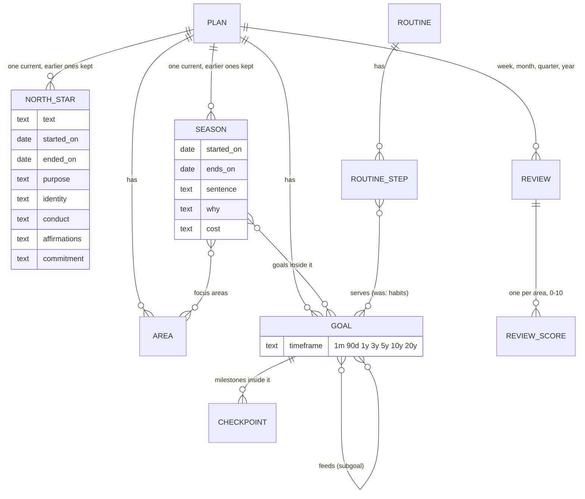

# Life plan rebuild: one home per idea, saves that send only what changed

**Status:** written and started 2026-11-04, after the owner said "Begin executing the plan in phases and
steps". The plan carries out the recommendations to Q1–Q10 in `Plans/life-plan-tables.md` section 7. Q11
(achievements) waits until this plan is done, as that answer said.

## What you are agreeing to, in plain words

- **No money.** Nothing is bought, rented or signed up for.
- **Your live database changes.** New tables and columns are added, and your plan's data is **copied**
  into them. **Nothing is deleted until Phase 7.**
- **Before every database change, a backup of your plan** goes to a file on this PC
  (`~/dg-backups/`), outside the code and readable only by your user.
- **The database rule says I ask before applying a change.** I ask once, at the first one (Phase 1),
  whether your yes covers Phases 1–6. Those phases only add and copy.
- **Phase 7 deletes the old copies.** Examples: the old one-thing history, old answer rows, and the
  goal-habit rows once they live as routine steps. **I list exactly what goes and ask you first.**
- **`/plan` changes as each phase lands**, because every push is live. Two steps merge into one, and new
  boxes appear: a north star history, a season, a timeframe per goal, and reviews.

## Doubt first

- This is the most carefully guarded code in the app. The save rules exist because plans were lost
  before. Every phase therefore runs on a throwaway test account first, never on your plan, and your
  plan is backed up before each database change.
- The plan is big: about 7 phases over several sessions. Each phase is its own commit and leaves `/plan`
  working, so it can stop between any two.
- Phases 4–6 are drawn more roughly than 1–3. Their details get fixed when each starts, from the code.

## What it is now, and where it ends up

Now: the browser holds the whole plan and sends **all of it** four seconds after every change. The
season lives in four unlinked places. The north star has one row and no history. Habits sit in two
places. Goals get copied into the old goals table.

Where it ends up (only the parts that change are drawn):

The steps go from 14 to 12. **Season** replaces **The one thing** and **Focus**. **Recap** becomes
**Review**. Question N1 below asks whether to merge two more pairs.

## Blockers, each tried once

| ID | What | Tried, and the result | Blocks | What happens |
|---|---|---|---|---|
| B-LIVE-DB | Apply each change to the live database | Linked from a scratch folder: a read-only query worked (it counted your rows). A write without consent answered `HostedMutationConsentRequiredError: ... ask the user before re-running with --yes. Nothing was changed.` | Phases 1–7 | I ask you once at Phase 1 for Phases 1–6. Phase 7 gets its own ask. |
| B-BACKUP | Copy your plan to a file before a change | Done in Phase 0, see the result there. | Every phase | None if Phase 0 works. |
| B-BROWSER | Click through `/plan` as a test account | Tried in Phase 0, see the result there. | The browser check in each phase | If login fails, the e2e test suite's login helper is used instead. |

## Open questions, each with a recommendation (taken if you say nothing)

| # | Question | Recommendation | If wrong |
|---|---|---|---|
| N1 | Merge two more pairs of steps? **Commit** into **North star** (the commitment becomes a north star box, per Q9). **Templates** into **Goals** (as a "start from a template" button). 12 steps would become 10. | Yes, done in Phase 3 together with Season. | Splitting them back out is a small change. |
| N2 | A weekly review: on a fixed day, or any day? | Any day. The app suggests Sunday and shows "last review: 9 days ago". | One setting. |
| N3 | A habit that becomes a routine step: which routine does it join? | A routine named after the goal, one per goal that had habits. You can move steps later. | Steps can be moved by hand. |

## Phases

### Phase 0. Backup and a starting picture (nothing changes)

1. Export every life plan row of your account (all `life_plan_*` tables, `life_answers`, `life_chapters`)
   read-only into `~/dg-backups/life-plan-2026-11-04.json` (mode 600). Record the row counts in this
   file.
2. Run the life plan's existing tests (unit, DB, e2e) once and record what is green before anything
   changes.
3. Try to sign in as a test account at localhost:3000 and open `/plan` (B-BROWSER).

**Done when:** the backup file exists and its counts match the live counts, and the starting test result
is written down here.

### Phase 1. Saves send only what changed; the account is the only copy (Q8)

1. **Save only what changed.** A pure function `diffRows(before, after)` gives, per table, the rows to
   write and the rows to remove. Link tables are compared by their two ids. Tested on its own.
2. **A new database function `apply_life_plan_changes`.** It writes those rows and removes only the rows
   named, in one transaction, with the same revision lock and the same row security (runs as you). It
   never deletes a row it was not told to delete: a half-loaded page can no longer wipe what it did not
   see. A whitelist of tables, so each later phase adds its tables in one line.
3. **The flow sends the diff.** It keeps what the account last accepted, as rows instead of a
   fingerprint. The old whole-plan `save_life_plan` stays in the database, unused, until Phase 7.
4. **The account is the only copy.** The browser no longer imports its own copy into the account. Your
   plan has been on the account since September (revision 919), and nobody else has one in a browser.
   The browser copy stays only so the page can paint before the read lands. It is never sent.
5. Tests: the diff function; the database function on the local test database (writes, removes only what
   is named, refuses a stale revision, refuses another person's plan); the flow's existing save tests
   adapted.

**Done when:** a test account's edit sends a small body, and the database shows only that row changed.
Your plan's row counts are unchanged. (The lock stays per plan: two devices editing at once still get
"reload". Locking per row would be its own job, not needed for one user.)

### Phase 2. The north star keeps its history and holds its four things (Q2, Q9)

1. `life_plan_north_stars` gets `started_on`, `ended_on`, `purpose`, `identity`, `conduct`,
   `affirmations`, `commitment`, `commitment_on`. "One per plan" becomes "one **current** per plan".
2. Copy your answers in: the north star step's prompts and the commit step's two answers move from
   `life_plan_answers` to the new columns. The old rows stay until Phase 7.
3. North star step: a "Start a new north star" button closes the current one with today's date, and an
   "Earlier north stars" list shows the old ones with their dates.

**Done when:** your current north star shows the same text and answers as before, read from the new
columns, and a test account can start a second one and see the first under "Earlier".

### Phase 3. One season (Q1), and the step list shortened (N1)

1. New tables: `life_plan_seasons` (start, planned end, actual end, the sentence, its why, its cost),
   `life_plan_season_areas` (ranked) and `life_plan_season_goals`.
2. Copy in what exists today: your one thing and its answers (`life_chapters`, `life_answers`), the
   focus areas (`season_rank`), the focus item (`season_focus_id`), and goals marked as serving the one
   thing. You have one chapter and no focus item set, so this makes one season.
3. One **Season** step replaces **The one thing** and **Focus**. The season band at the top reads the
   current season. "Start a new season" ends the current one and keeps it as history.
4. If N1 stands: Commit folds into North star, and Templates into Goals.

**Done when:** your one thing appears as the sentence of your current season, every step reads the
season from one place, and `TAB_ORDER` lists the new steps.

### Phase 4. Goals: timeframe, subgoals, habits as routine steps, no copy (Q3–Q6)

1. Q6: a `timeframe` column on goals (1 month, 90 days, 1, 3, 5, 10 or 20 years), chosen on the goal
   card and used to group the goals list.
2. Q3: a goal can feed a bigger goal (`goal_feeds`). Both goals show it: "Feeds: X" and "Subgoals: A,
   B". Checkpoints stay as the milestones inside one goal; sub-steps stay a to-do list.
3. Q5: each goal habit becomes a routine step that serves the goal (N3). Your 13 habit rows are copied
   over; the old rows stay until Phase 7.
4. Q4: the Track step stops copying goals into the old `user_goals`. None of your 50 goals are linked,
   so nothing moves; counts are kept as day rows. The old table and its 91 rows of yours are untouched:
   other parts of the app use them.

**Done when:** each of the four shows on a test account, your 13 habits show as routine steps, and a
Track run adds no `user_goals` rows.

### Phase 5. Reviews: week, month, quarter, year (Q7)

1. `life_plan_reviews`: how often, the period, magic moments, lessons, next outcomes. Plus
   `life_plan_review_scores`: one 0–10 score per area.
2. The fortnight scores on your areas are copied in as your first review.
3. **Recap** becomes **Review**: pick week, month, quarter or year; score each area (Stefan's minimum is
   7); write magic moments and next outcomes; see the earlier reviews of the same kind (N2).

**Done when:** a test account can do one review of each kind, the scores show over time, and your
fortnight scores appear as your first review.

### Phase 6. Your own Today boxes can hold a number (Q10)

A Today box gets a "number" kind (e.g. approaches, minutes, kilos). The value is stored on the day row
and shown on the day's summary. Concept items 21 and 34.

**Done when:** a test account can add a number box, type a number, reload, and see it.

### Phase 7. Clear out the old homes (deletes: your yes first)

The list, final once Phases 1–6 are done: `save_life_plan`, `life_plans.season_focus_id`,
`life_plan_areas.season_rank` and `review_fortnight`, `life_plan_goals.serves_one_thing` and
`user_goal_id`, the north-star and commit rows in `life_plan_answers`, `life_plan_goal_habits`,
`life_chapters`, and the `one_*` rows in `life_answers`, plus the code that reads them. A fresh backup
first. **I ask you before this phase, with the list and the counts.**

## Ground rules for every phase

- Backup before each database change; `migration list` right before applying, because other sessions add
  migrations too; a `.down.sql` beside each migration in `supabase/migrations/rollback/`.
- Every new table locked to its owner (row security), with a test that another account cannot read it.
- Test accounts only for clicking through. Your plan is read, never written by a test.
- Before each push: the test suite, the type ratchet and the lint ratchet. `/code-review` per phase; a
  security review where row security changes. Commit with `git commit --only`, then push.
- At the end of each phase, a short report in plain words, and this file updated with what was done.
