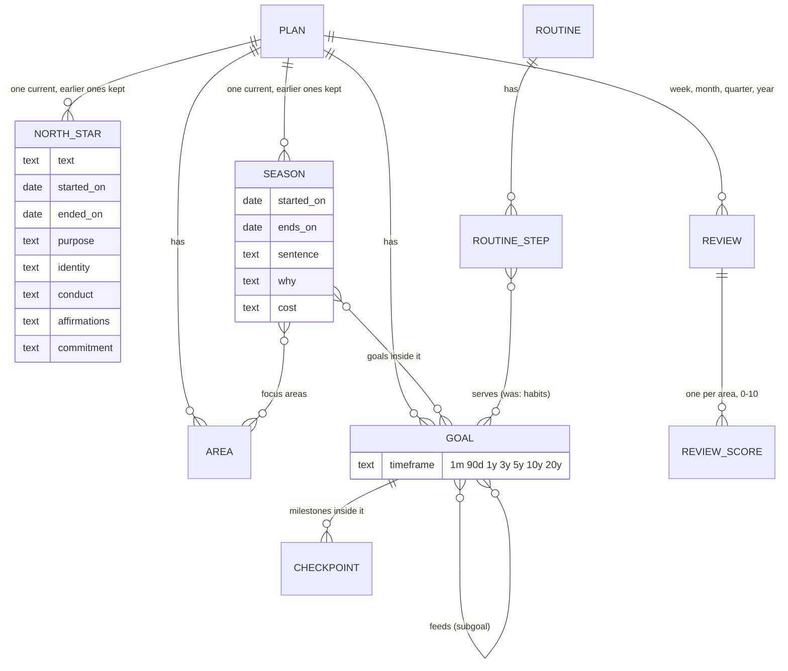

# Life plan rebuild: one home per idea, saves that send only what changed

**Status:** written and started 2026-11-04, after the owner said "Begin executing the plan in phases and
steps". The plan carries out the recommendations to Q1–Q10 in `Plans/life-plan-tables.md` section 7. Q11
(achievements) waits until this plan is done, as that answer said.

**Sign-off rule (the owner, 2026-11-04):** "i need to eventually see a visual thing of it before we can
say anything is done or good." So a phase here is *built* or *live*, never *done*, until the owner has
looked at it and marked it. The page he marks: https://claude.ai/artifact/K5r4E4ywmrHfasxNPwdXsr
(pictures of every `/plan` step, taken on a copy of his plan in a test account; marks in its `marks`
store). The pictures come from `tests/e2e/life-plan-tour.spec.ts`. Read the marks before the next phase.

## What you are agreeing to, in plain words

- **No money.** Nothing is bought, rented or signed up for.
- **Your live database changes.** New tables and columns are added, and your plan's data is **copied**
  into them. **Nothing is deleted until Phase 7.**
- **Before every database change, a backup of your plan** goes to a file on this PC
  (`~/dg-backups/`), outside the code and readable only by your user.
- **The database rule says I ask before applying a change.** Asked at Phase 1 on 2026-11-04. **Your
  answer: "Yes, Phases 1–6".** Those phases only add and copy.
- **Phase 7 deletes the old copies.** Examples: the old one-thing history, old answer rows, and the
  goal-habit rows once they live as routine steps. **I list exactly what goes and ask you first.**
- **`/plan` changes as each phase lands**, because every push is live. Two steps merge into one, and new
  boxes appear: a north star history, a season, a timeframe per goal, and reviews.

## Doubt first

- This is the most carefully guarded code in the app. The save rules exist because plans were lost
  before. Every phase therefore runs on a throwaway test account first, never on your plan, and your
  plan is backed up before each database change.
- The plan is big: about 7 phases over several sessions. Each phase is its own commit and leaves `/plan`
  working, so it can stop between any two.
- Phases 4–6 are drawn more roughly than 1–3. Their details get fixed when each starts, from the code.

## What it is now, and where it ends up

Now: the browser holds the whole plan and sends **all of it** four seconds after every change. The
season lives in four unlinked places. The north star has one row and no history. Habits sit in two
places. Goals get copied into the old goals table.

Where it ends up (only the parts that change are drawn):

The steps go from 14 to 12. **Season** replaces **The one thing** and **Focus**. **Recap** becomes
**Review**. Question N1 below asks whether to merge two more pairs.

## Blockers, each tried once

| ID | What | Tried, and the result | Blocks | What happens |
|---|---|---|---|---|
| B-LIVE-DB | Apply each change to the live database | Linked from a scratch folder: a read-only query worked (it counted your rows). A write without consent answered `HostedMutationConsentRequiredError: ... ask the user before re-running with --yes. Nothing was changed.` | Phases 1–7 | I ask you once at Phase 1 for Phases 1–6. Phase 7 gets its own ask. |
| B-BACKUP | Copy your plan to a file before a change | Worked (Phase 0): a read-only query wrote every row of yours to `~/dg-backups/`. | Every phase | Nothing. |
| B-BROWSER | Click through `/plan` as a test account | The browser test suite starts its own copy of the app on a throwaway local database and signs in its own test accounts: 7 life plan browser tests ran (Phase 0). | The browser check in each phase | Each phase's browser check is a browser test in that suite, never your account. |

## Open questions, each with a recommendation (taken if you say nothing)

| # | Question | Recommendation | If wrong |
|---|---|---|---|
| N1 | Merge two more pairs of steps? **Commit** into **North star** (the commitment becomes a north star box, per Q9). **Templates** into **Goals** (as a "start from a template" button). 12 steps would become 10. | Yes, done in Phase 3 together with Season. | Splitting them back out is a small change. |
| N2 | A weekly review: on a fixed day, or any day? | Any day. The app suggests Sunday and shows "last review: 9 days ago". | One setting. |
| N3 | A habit that becomes a routine step: which routine does it join? | A routine named after the goal, one per goal that had habits. You can move steps later. | Steps can be moved by hand. |

## Phases

### Phase 0. Backup and a starting picture (nothing changes)

1. Export every life plan row of your account (all `life_plan_*` tables, `life_answers`, `life_chapters`)
   read-only into `~/dg-backups/life-plan-2026-11-04.json` (mode 600). Record the row counts in this
   file.
2. Run the life plan's existing tests (unit, DB, e2e) once and record what is green before anything
   changes.
3. Try to sign in as a test account at localhost:3000 and open `/plan` (B-BROWSER).

**Done when:** the backup file exists and its counts match the live counts, and the starting test result
is written down here.

**Done 2026-11-04.** `~/dg-backups/life-plan-2026-11-04.json` (mode 600) holds 873 rows of yours in
27 tables. Among them: 1 plan, 155 nodes, 1 north star, 12 areas, 50 goals, 48 checkpoints, 13 goal
habits, 7 routines, 24 routine steps, 70 routine-area links, 339 values, 7 answers, 13 days, 36
ratings, 95 ticks, 1 chapter and 1 life answer. The other tables are empty for you. Tests before any
change:
- unit (goals and the two life plan repos): 1568 passed, 82 files;
- database: 25 passed, 4 files;
- browser: 7 passed. `life-mastery-track.spec.ts:219` failed once on the first request after the app
  started and passed on the rerun, so it is flaky, not broken.

### Phase 1. Saves send only what changed; the browser copy is per account (Q8)

1. **Save only what changed.** A pure function `diffRows(before, after)` gives, per table, the rows to
   write and the rows to remove. Link tables are compared by their two ids. Tested on its own.
2. **A new database function `apply_life_plan_changes`.** It writes those rows and removes only the rows
   named, in one transaction, with the same revision lock and the same row security (runs as you). It
   never deletes a row it was not told to delete: a half-loaded page can no longer wipe what it did not
   see. A whitelist of tables, so each later phase adds its tables in one line.
3. **The flow sends the diff.** It keeps what the account last accepted, as rows instead of a
   fingerprint. The old whole-plan `save_life_plan` stays in the database, unused, until Phase 7.
4. **The browser copy belongs to one account.** *Changed while building:* the browser keeps its copy, because
   it is the only place a new account's work survives a first save that was cut off halfway (rule 2 in
   `lifePlanSync.ts`). But it was stored under one name for every account and never cleared on sign-out.
   So on a shared browser, the next person to sign in saw the last person's plan, and with an empty
   account had it imported as theirs. It is now stored per account, and the old shared copy is deleted
   on load. Also removed: the goals screen's write into that shared copy (`northStarStorage.ts`). The
   flow already re-reads the running program from the account on every load.
5. Tests: the diff function; the database function on the local test database (writes, removes only what
   is named, refuses a stale revision, refuses another person's plan); the flow's existing save tests
   adapted.

**Done when:** a test account's edit sends a small body, and the database shows only that row changed.
Your plan's row counts are unchanged. (The lock stays per plan: two devices editing at once still get
"reload". Locking per row would be its own job, not needed for one user.)

**Done 2026-11-04**, shipped in one commit with Phase 2 because both change the same files.
- Live database: `20261104100000` (the change-only save), `20261104100100` (signed-out visitors can call
  neither save), `20261104100200` (the review's fix, below).
- A separate review agent found six problems, all fixed before the push:
  1. **High.** The save compared with a plan rebuilt from the read. The loader adds what a plan lacks
     (12 default areas, the north star's node), so on an account whose plan row held nothing every save
     failed, and reloading did not help. It now compares with the rows exactly as the account returned
     them.
  2. Deleting the old shared browser copy could delete work only that browser had. It is moved aside to
     `north-star-v1:orphan` instead, and is on the Phase 7 list.
  3. If another device saved between the read and the first save, the page said "could not save" on
     every edit. It now says "reload".
  4. **Security.** A signed-in person calling the function directly could point a new goal at another
     account's counted goal. That blocks that account's Track push. The function no longer writes that
     column at all, and checks itself on install.
  5. With nothing known about the account, values and answers were still replaced (wiped and rewritten).
     They are now only written.
  6. No test read what the page sends. `flowSendsOnlyTheChange.test.tsx` now does: one edit sends one
     row, and an empty plan row gets every part.

### Phase 2. The north star keeps its history and holds its four things (Q2, Q9)

1. `life_plan_north_stars` gets `started_on`, `ended_on`, `purpose`, `identity`, `conduct`,
   `affirmations`, `commitment`, `commitment_on`. "One per plan" becomes "one **current** per plan".
2. Copy your answers in: the north star step's prompts and the commit step's two answers move from
   `life_plan_answers` to the new columns. The old rows stay until Phase 7.
3. North star step: a "Start a new north star" button closes the current one with today's date, and an
   "Earlier north stars" list shows the old ones with their dates.

**Done when:** your current north star shows the same text and answers as before, read from the new
columns, and a test account can start a second one and see the first under "Earlier".

**Built 2026-11-04.** Migration `20261104130000` adds the columns and copies your one north star
answer (`star_why`, 335 characters) into `purpose`. The new one's start date is the day your plan row
was made. The answers are written to both places until Phase 7. "Start a new north star" keeps the
purpose, identity, code, becoming and affirmations as a starting point, but empties the commitment: it
was made to the old picture. Browser test: `tests/e2e/life-mastery-north-star-history.spec.ts`.

**Live 2026-11-04** (commit `31eb59ce`, then the migration, in that order: the old page's whole-plan save
cannot fill the new columns). Checked on your account: the paragraph unchanged (1,521 characters), the
why copied into `purpose` (335 characters, identical), started on 23 Sep 2026, current. Backup before it:
`~/dg-backups/life-plan-2026-11-04-before-phase2.json`.

### Phase 3. One season (Q1), and the step list shortened (N1)

1. New tables: `life_plan_seasons` (start, planned end, actual end, the sentence, its why, its cost),
   `life_plan_season_areas` (ranked) and `life_plan_season_goals`.
2. Copy in what exists today: your one thing and its answers (`life_chapters`, `life_answers`), the
   focus areas (`season_rank`), the focus item (`season_focus_id`), and goals marked as serving the one
   thing. You have one chapter and no focus item set, so this makes one season.
3. One **Season** step replaces **The one thing** and **Focus**. The season band at the top reads the
   current season. "Start a new season" ends the current one and keeps it as history.
4. If N1 stands: Commit folds into North star, and Templates into Goals.

**Done when:** your one thing appears as the sentence of your current season, every step reads the
season from one place, and `TAB_ORDER` lists the new steps.

**Built 2026-11-04.**
- Migration `20261104140000` makes the three tables and copies each plan's season into them.
  `20261104140100` lets the save reach them.
- Your copy will be one season. Its sentence is your one thing (22 characters), and it runs from 28 Aug to
  31 Dec 2026, from its chapter. It also gets your why, cost, identity, values and areas answers, your three
  focus areas in their order (Relationship, Health, Mission), and the 1 goal marked as serving it.
- **Where the step sits.** Season is step 7, where Focus was: after goals and experiences, because a
  season picks areas and goals that already exist, and Stefan's order is yearly goals, then the 90-day
  focus. "The one thing" was step 3; old links to it open Season. The steps are now 13; N1 is not done
  yet.
- **What the box does now.** The one-thing box writes into the plan's season and is saved with the
  plan. It no longer uses its own route (`/api/life-answers`), which stays unused until Phase 7.
  Rewording keeps the season. Moving the date changes its end. "Start a new one" ends the season and
  keeps it whole, with its answers, areas, focus and goals, then opens an empty one.
- **Found while testing.** The plan from your account replaces the one on screen a moment after the
  page opens. A sentence saved in that moment was lost. The box now waits for your account before it
  saves. Browser test: `tests/e2e/life-mastery-season.spec.ts`.
- **A second review agent found nine problems, all fixed before going live.**
  1. **High.** On a plan with nothing else written, a first one thing was never saved; it was lost on
     reload. The page's two "is the plan empty?" checks now count the season.
  2. A first sentence on a season that already had focus areas kept no start date and no deadline.
     The countdown could read "lapsed", and the next save would have cleared the areas. It now starts
     that day, with a deadline.
  3. "Next" on Your 10s went nowhere.
  4. The tracking page still showed the old one thing.
  5. Earlier one things would have vanished from the history. They are copied as past seasons
     (dry-run on the test database, rolled back).
  6. Deploy order: database first, push straight after.
  7. The sentence showed twice on the Season step.
  8. Season changes did not stamp the plan's "last changed" time.
  9. Three tests could not fail. They now check the redirect, a plan holding only a one thing, and the
     Season step reaching "done".
- **Live 2026-11-04** (migrations, then commit `4cd83de7`). Your season, read back: `season:s1`, 28 Aug to
  31 Dec 2026, the sentence (22 characters), the why, cost, identity, values and areas answers, the areas
  Relationship, Health, Mission & Purpose in that order, and 1 goal. 879 rows: the 873 from before, plus 6.
- **A correction.** I first reported an area stored as "Mission &amp;amp; Purpose". That was wrong. The
  backup method (`query_to_xml`) escapes `&`, `<` and `>` as XML. The backups made before Phases 1–3
  carry that escaping in their text; the data never had it. `life-plan-2026-11-04-after-phase3.json` is
  made with `json_agg`, one table at a time, and is exact. Your plan's data did not change between the
  backups (revision 919 throughout), so that file also stands for the old tables.
- **N1, live 2026-11-04** (commit `a131e905`; not yet marked by the owner), and placed differently from what N1 said, because the screens showed more
  than the plan did:
  - **Commit folded into Everything, not into North star.** Commit holds the whole read-back, the "does
    the plan aim at your 10s" check and "what could go wrong", and committing comes after the plan
    exists, so on step 1 it would make no sense. Everything is the plan read back, so the commit work
    now ends it, in place of Everything's read-only copy of those same answers. Everything moved to
    Commit's place (step 8, before Track). Its ring fills on the commitment alone. The commitment is
    still stored on the north star (Phase 2).
  - **Templates folded into Where to start, not into a goals step** (there is no goals step: goals live
    on Systems and Experiences). It is a fourth door, "Start from a ready-made set", closed until asked.
  - The steps are now 11. `?step=commit` and `?step=templates` still work: they open the new home, on
    the part they were for (`stepFor` in `src/goals/data/northStar.ts`).
- **The floor of 7 removed**, at the owner's word the same day: "you can remove the floor of 7 entirely
  as a push towards directing the user to what they need to do. They can figure that out themselves."
  Gone: the "Under a seven right now" lines, the floor notes, amber scores under 7, the wheel's dashed
  ring at 7, the values check built on it, and its "still to fill in" chip. Asked, not removed: the
  "N more values to reach seven" chip (a different seven: the length of the values list).
- **Found while taking the pictures:**
  - `tests/e2e/one-thing.spec.ts` had been red since Phase 3: it still waited for the retired
    `/api/life-answers` route. Rewritten onto the season.
  - The "Running since" line (proof that a reword did not restart the clock) never showed since Phase
    3, because a season counts no rewordings. It now shows on any season begun before today.
  - The browser tests' seed helper stopped clearing the previous plan once saves sent only changes, so
    a second test on the same account was refused. It now diffs against what the account holds.
- **Review agent, before the push:** one bug (my wait-for-the-account on the Commit link's scroll also
  held back every other "go to it" jump when the account was unreachable or had no plan row yet; now
  only that one anchor waits), plus three leftovers fixed: a last "hold their floor" on the catalogue's
  load meter, "Running since" moved to a rule that takes today instead of bending the `extended` flag,
  and the Weekly Review goal's link now says where the review is. Checks: 5,700 unit tests, 21 life plan
  browser tests (`life-mastery-track.spec.ts:219` flaked once under load and passed twice alone), no new
  type errors. The lint ratchet could not run: other sessions' `.claude/worktrees/` swamp its JSON.

### Phase 4. Goals: timeframe, subgoals, habits as routine steps, no copy (Q3–Q6)

1. Q6: a `timeframe` column on goals (1 month, 90 days, 1, 3, 5, 10 or 20 years), chosen on the goal
   card and used to group the goals list.
2. Q3: a goal can feed a bigger goal (`goal_feeds`). Both goals show it: "Feeds: X" and "Subgoals: A,
   B". Checkpoints stay as the milestones inside one goal; sub-steps stay a to-do list.
3. Q5: each goal habit becomes a routine step that serves the goal (N3). Your 13 habit rows are copied
   over; the old rows stay until Phase 7.
4. Q4: the Track step stops copying goals into the old `user_goals`. None of your 50 goals are linked,
   so nothing moves; counts are kept as day rows. The old table and its 91 rows of yours are untouched:
   other parts of the app use them.

**Done when:** each of the four shows on a test account, your 13 habits show as routine steps, and a
Track run adds no `user_goals` rows.

### Phase 5. Reviews: week, month, quarter, year (Q7)

1. `life_plan_reviews`: how often, the period, magic moments, lessons, next outcomes. Plus
   `life_plan_review_scores`: one 0–10 score per area.
2. The fortnight scores on your areas are copied in as your first review.
3. **Review**: pick week, month, quarter or year; score each area (no floor: removed 2026-11-04); write
   magic moments and next outcomes; see the earlier reviews of the same kind (N2). *Changed since
   written:* Recap (Everything) now holds the commit work (N1), so it stays; where Review goes is settled
   when this phase starts.

**Done when:** a test account can do one review of each kind, the scores show over time, and your
fortnight scores appear as your first review.

### Phase 6. Your own Today boxes can hold a number (Q10)

A Today box gets a "number" kind (e.g. approaches, minutes, kilos). The value is stored on the day row
and shown on the day's summary. Concept items 21 and 34.

**Done when:** a test account can add a number box, type a number, reload, and see it.

### Phase 7. Clear out the old homes (deletes: your yes first)

The list, final once Phases 1–6 are done: `save_life_plan` and the PUT on `/api/life-plan`, the old
shared browser copy kept as `north-star-v1:orphan`, `life_plans.season_focus_id`,
`life_plan_areas.season_rank` and `review_fortnight`, `life_plan_goals.serves_one_thing` and
`user_goal_id`, the north-star and commit rows in `life_plan_answers`, `life_plan_goal_habits`,
`life_chapters`, and the `one_*` rows in `life_answers`, plus the code that reads them. A fresh backup
first. **I ask you before this phase, with the list and the counts.**

## Ground rules for every phase

- Backup before each database change; `migration list` right before applying, because other sessions add
  migrations too; a `.down.sql` beside each migration in `supabase/migrations/rollback/`.
- Every new table locked to its owner (row security), with a test that another account cannot read it.
- Test accounts only for clicking through. Your plan is read, never written by a test.
- Before each push: the test suite, the type ratchet and the lint ratchet. `/code-review` per phase; a
  security review where row security changes. Commit with `git commit --only`, then push.
- At the end of each phase, a short report in plain words, and this file updated with what was done.
