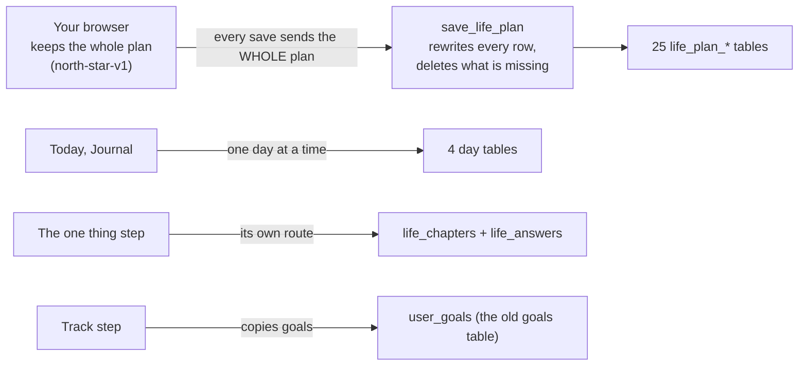
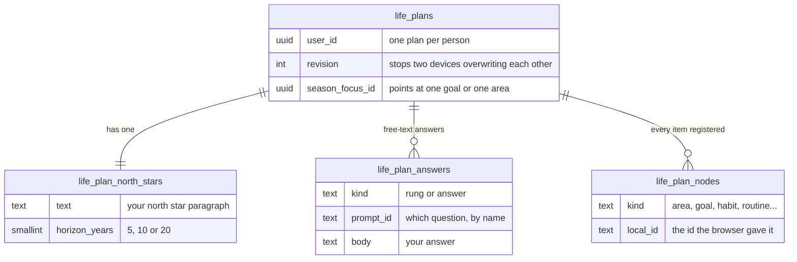
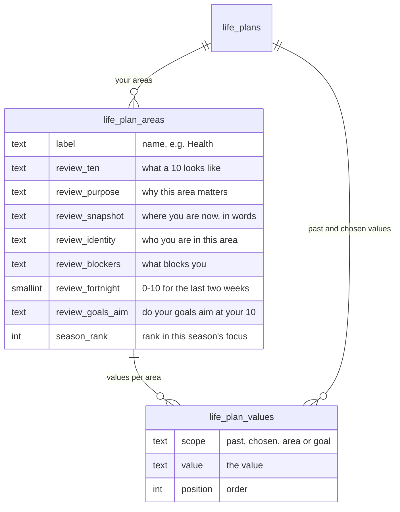
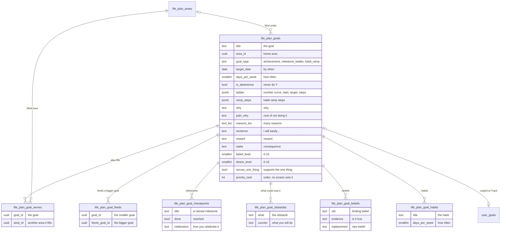
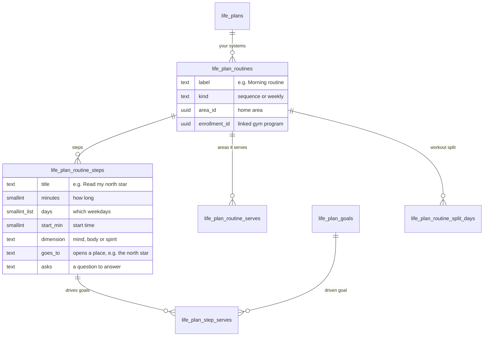
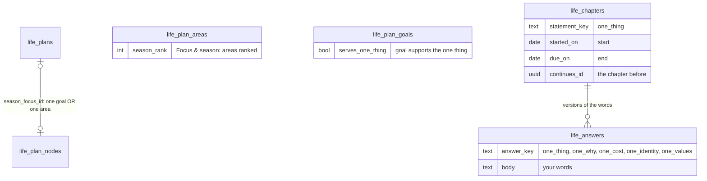
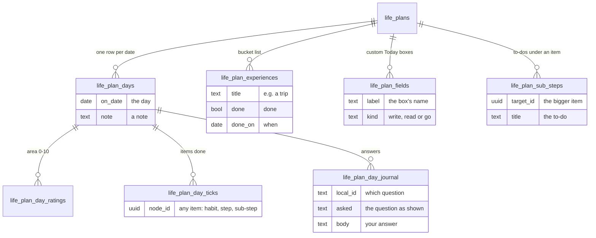

# The life plan's tables: what each holds, what it gives the user, and what is open

**Written 2026-11-03** for the owner, as the result of `Plans/life-plan-map.md`. Read-only: nothing in
the app or the database was changed. The same content as a visual page:
https://claude.ai/artifact/WYuC23e2TqVp5chxdFkXYW

**Sources, in order of weight.**
1. **Your own words.** 653 messages (prompt history Feb–Mar 2026, chats 25 Sep – 3 Nov 2026), 111 kept;
   your 34-point list `docs/product/life-mastery-concept.md` (written by you, 17 Sep 2026); your items in
   `docs/product/vision.md`.
2. **Your words quoted in my old notes** (second-hand): about 75 passages from June to early September
   2026, found in commit history, deleted plan files included.
3. **Stefan James's videos**: 374 transcripts in `~/.cache/lm-corpus/text/`; every point below was
   matched word for word in a transcript.
4. **The tables**: `supabase/migrations/20260922100000_life_plan_tables.sql` and the later life plan
   migrations, `src/db/*Repo.ts`, and the code that reads and writes them.

**Doubt first.**
- "Does it work" is judged from the code only. Nothing was clicked through or test-saved this time.
- Your words from April and May 2026 are gone everywhere. June–September survives only second-hand.
- The live database's own layout could not be read (needs your password). If a column was added by hand
  in Supabase, it is missing here.

---

## 1. How it is built, in one picture

Four separate ways in. The life plan was built in the browser first. When it moved to the database in
September, every list in the browser's plan object became a table, one to one. So the tables copy the
browser's shape; they were not designed on their own.

## 2. The tables

### 2.1 The plan and the north star

- **What it gives you.** The *North star* step: your vision paragraph, 5/10/20 years, the vision ladder
  ("rungs"), and answers to "Why is this important to you?", "Who are you?", "What do you hold yourself
  to?", "who do you need to become", "Your affirmations". The *Commit* step: your commitment and its
  date. The *Track* step: "What might stop you overall?" and "Who needs to know, and who could help?".
  All of these are rows in `life_plan_answers`, found by question name.
- **Stefan.** His top element is the *Ultimate Vision*, 10–50 years out (Kz83kMosOWU), with the
  *Ultimate Purpose*, *identity* and *code of conduct*: "the four things", re-read weekly (8kco2rjijjE).
  He never says "north star".
- **You said.** "alle vil jo have en northstar, men man kan kun have én northstar af gangen, men flere
  over tid" (23 Oct). Your drawing gives NorthStar a DateStart and DateEnd. Concept item 24: "en
  langsigtet nordstjerne".
- **Problems.**
  - Only one north star per person, overwritten in place, with no dates. Old ones are lost. You asked
    for several over time.
  - Purpose, identity, code of conduct, affirmations and the commitment are not columns. They are loose
    rows keyed by a question name in code. The database does not know they exist, and renaming a
    question in code orphans its answer.

### 2.2 Areas ("Your 10s") and values

- **What it gives you.** *Your 10s*: rate each area, write the 10, purpose, identity, blockers.
  *Focus & season*: rank areas for the season. *Values & identity*: your current values and the ones you
  choose.
- **Stefan.** Areas are the user's own (7, 10 or 12 in different videos), each with a "cool name", a
  vision, a purpose and roles (Rw2qaMltFcY, 8kco2rjijjE). Rated 0–10 **every week** on the Life
  Mastery Circle, minimum 7 (wqJ-2N5KVOU). Values are a ranked hierarchy, each with rules ("I feel
  happiness anytime I…", KuVQ5wpcIvg).
- **You said.** Concept 17 and 18: "Vi kan rate vores nuværrende vurdering af hvert livsområde, og en
  vurdering af hvad vores 10 ville se ud". Concept 28 and 31: values, and "hvilke er vigtige?".
- **Problems.**
  - The area review is one set of answers, overwritten. There is no history of how an area went.
  - The same rating is kept twice: `review_fortnight` on the area, and a daily rating per area in the
    day tables (2.6).
  - The season is stored inside the area (`season_rank`), with no dates.
  - Values: one table for four kinds. There is no ranking beyond the order, no rules and no "away"
    values. `vision.md` item 19 says "Value prioritisation: not built at all".

### 2.3 Goals

- **What it gives you.** Goal cards on the *Systems* and *Experiences* steps. Goals added from the
  catalogue on *Templates* and *Where to start*. On each goal: type, date, how often, why, reasons,
  "I will easily…", belief and desire, reward and consequence, milestones, obstacles, beliefs, habits,
  which bigger goal it feeds, which other areas it lifts.
- **Stefan.** One-year goals per area (15–20 of them in tYCT57Onfas), result and process goals
  (ZywgvFSnH38), "I will easily…", belief and desire of at least 7 (AuRE42mCwlU), why as pleasure and
  pain, 100 reasons, obstacles, resources, a could-do list cut to an action plan, reward and consequence
  (GXhPOncX8CA), then cut into **90-day and monthly goals** (8kco2rjijjE).
- **You said.** Concept 1–15 (end date, achievable, scales up, frequency, always X, never Y, do Z
  things, why, better why, needs a system). "goals nu i mit rigtige projekt har undermål, systemer
  osv., så vil jeg ikke fjerne al kompleksiteten" (23 Oct). "hvordan ser man så hvad overmålet er ?"
  (23 Oct). "stop weed" lifts every area (23 Oct). Second-hand, Aug: "milestones are not that, they are
  separate from what we track each week".
- **Problems.**
  - **No "subgoal" column.** Five things play that part: `goal_feeds` (a goal feeding a bigger goal),
    checkpoints, the `ladder` curve, `ramp_steps`, and sub-steps (2.6). "Overmålet" is only visible
    if you linked the goal with `goal_feeds`.
  - **The same goal lives in two tables.** The Track step copies goals into the old `user_goals`
    (2.7) so they can be counted.
  - **Lists hidden inside one cell** (`ladder`, `ramp_steps`, `reasons_list`, habits' `routine_days`).
    The database cannot link to them or count them.
  - **Two homes for "something I do regularly":** a goal's habits here, and routine steps in Systems
    (2.4).
  - Milestones are two things: named checkpoints, and the number curve in `ladder`.
  - No timeframe per goal (Stefan's 1/3/5/10/20 years, 90-day, monthly).

### 2.4 Systems (routines)

- **What it gives you.** The *Systems* step builds routines (morning, evening, deep work, workouts),
  their steps, days and times, and which goals each step drives. Today shows the steps, and a step can
  open your north star or ask a journal question.
- **Stefan.** Rituals per area (Kz83kMosOWU). A morning ritual for body, mind and spirit (PPlaK8y4PzA),
  an evening ritual, short "daily rituals" before big moments, a 30-day trial for anything new, time
  blocks in the calendar (mDHWi92v9X8).
- **You said.** Concept 11, 12, 16 and 26. Second-hand, Aug: "where has deep work gone? i dont see it as
  a driver, even tho ive chosen the business routine", and you should pick the days inside the routine.
- **Problems.** Mostly sound. Split days copy the gym program's days and are kept only when no gym
  program is linked.

### 2.5 Season focus and the one thing: four places for one idea

- **What it gives you.** *The one thing* step: a sentence ("Quit weed for 100 days") with a start and
  an end date, a why, a cost, an identity and values. Old versions are kept. *Focus & season*: rank
  areas. A season band elsewhere shows `season_focus_id` (one goal or one area).
- **Stefan.** No "season", no "north star". "The one thing" appears only as a book about one big task
  each day (OgRGJBpTOeU). What he does have: the year's 1–3 most important areas (JZnLIuW7NQw), the top
  2–3 goals (ZywgvFSnH38), 90-day goals, and 100-day challenges (GXhPOncX8CA).
- **You said.** "der er jo også en end date" (23 Oct). "et season fokus har også indbygget et mål" (23
  Oct). "men season fokus kan også være flere områder" (23 Oct). Concept 24: "denne sæsons fokus,
  prioriteter fx i form af hvilket livsområder er vigtigst eller hvilke delmål". Second-hand, Aug: "it
  takes flat bench as my one thing, even though i input 100 days of no weed", and "It still says this
  season is for flat benching, but where is that coming from (even if it says that quitting weed for 100
  days is the one thing)".
- **Problems.** The four places do not point at each other, and the season focus alone can be set from
  five different steps. The one thing has dates but no goal and no
  areas. The season focus points at one thing but has no dates. The season areas have neither. None of
  them can be what you described: one season with an end date, a goal inside it, several areas.

### 2.6 The day: Today, Journal, Track, plus experiences, fields and sub-steps

- **What it gives you.** *Today*: tick items, rate areas, fill your own boxes, sub-steps under a bigger
  item. *Journal*: answer questions, read old answers. *Track*: weeks at a glance. *Experiences*: a
  bucket list per area or goal.
- **Stefan.** Five Minute Journal morning and evening (PPlaK8y4PzA), three daily outcomes or "top three
  musts", **weekly** area scores 0–10, weekly magic moments and lessons, weekly outcomes per area
  (8kco2rjijjE), then monthly, quarterly and yearly reviews (JZnLIuW7NQw).
- **You said.** Concept 21: tracking of self-defined things, e.g. "hvor meget har jeg lyst til at stå op
  om morgenen". Concept 27: "en todo med 20 ting … færdig om 20 dage". Concept 34: rate your own effort
  per action. 4 Mar: "the daily reflections help with the weekly/monthly/yearly goals". Second-hand,
  Aug: a journal page that shows "ALL old reports".
- **Problems.**
  - No weekly, monthly, quarterly or yearly review: Stefan's whole review rhythm has no table.
  - Your own boxes can hold text, open something, or link somewhere, but not a number. So "how much do I
    want to get up" cannot be tracked.
  - Sub-steps have no deadline (your "20 things in 20 days").
  - No rating of your own effort per action (concept 34).

### 2.7 The old goals table (`user_goals`)

More than 40 columns from the older goals system: title, category, tracking type, period, target and
current value, streaks and streak freezes, life area (as text), **parent goal**, goal level (L1/L2/L3),
template, milestone config, ramp steps, abstinence, stages, values. The life plan's Track step copies
your plan goals into it, so they can be counted.

- **You said.** 27 Feb: "IF i make a change to the goal structure, users shouldnt be left with broken
  code". Feb–Mar: L1/L2/L3, "higher level goals", habit ramp, curve editor.
- **Problems.** The same goal is stored twice. This old table has a parent-goal column; the new one
  does not.

## 3. Your 34-point list against the tables

✓ = has a home · ◐ = partly · ✗ = no home · – = not data (logic or wording)

| # | Your item (short) | Where it lives | |
|---|---|---|---|
| 1 | Some goals have an end date | `goals.target_date` | ✓ |
| 2 | Some goals are a condition you reach | `goal_type = achievement` | ✓ |
| 3 | Some goals scale up naturally | `goal_type = milestone_ladder`, curve in `ladder` | ✓ |
| 4 | Some goals are wanted by a date | `goals.target_date` | ✓ |
| 5 | Some goals are SMARTer than others | `goals.sentence`; nothing checks it | ◐ |
| 6 | Some goals are a frequency | `days_per_week`, `per_week` | ✓ |
| 7 | A frequency that can be achieved | frequency exists; no "achieved" rule stored | ◐ |
| 8 | A frequency that grows | `goal_type = habit_ramp`, `ramp_steps` | ✓ |
| 9 | Some goals have a why | `why`, `reasons_list` | ✓ |
| 10 | Some have a better why | `pain_why`, `asked` | ◐ |
| 11 | Some goals need a system | routines + `step_serves` | ✓ |
| 12 | Systems: morning, evening, deep work, workouts | `life_plan_routines` | ✓ |
| 13 | Always do X | only as 7 days a week | ◐ |
| 14 | Never do Y | `is_abstinence` | ✓ |
| 15 | Do Z things | a target number in `ladder` | ◐ |
| 16 | Goals, systems and areas connect | `area_id`, `goal_serves`, `routine_serves`, `step_serves` | ✓ |
| 17 | Life areas exist | `life_plan_areas` | ✓ |
| 18 | Rate now, describe your 10, build towards it | `review_ten`, ratings | ✓ |
| 19 | Experiences, feelings, identity | `feeling`, `review_identity`, `one_identity` | ◐ |
| 20 | A list of experiences; identity, affirmations, why | `life_plan_experiences`; affirmations are one text box | ◐ |
| 21 | Constant tracking, incl. self-defined things | area ratings only; own boxes hold no number | ◐ |
| 22 | Achievements (100 in total, 10 in a day) | nothing | ✗ |
| 23 | Automate the chain, help define systems | – | – |
| 24 | Levels: north star, season focus, priorities | north star ✓; season scattered (2.5); `priority_rank` set by no screen | ◐ |
| 25 | A few key drivers per thing | `step_serves`, `goal_feeds` | ◐ |
| 26 | Journal, read north star, affirmations, to-do as a frequency | routine steps that open or ask; day journal | ✓ |
| 27 | A 20-item to-do done in 20 days | sub-steps, no deadline | ◐ |
| 28 | Values through the north star and single goals | `life_plan_values` (chosen, goal) | ✓ |
| 29 | Practical actions vs motivation framing | – | – |
| 30 | Achievements that connect logically | nothing | ✗ |
| 31 | Which values and goals matter most | order only | ◐ |
| 32 | Celebrating yourself | `checkpoints.celebration`, `goals.reward` | ✓ |
| 33 | What could stop you, and a plan against it | `life_plan_goal_obstacles` | ✓ |
| 34 | Rate your own effort per action | nothing | ✗ |

## 4. Stefan's system against the tables

| His element | In the tables? |
|---|---|
| Ultimate Vision, Purpose, identity, code of conduct | ✓ north star text; the other three as loose answers |
| Mission statement | ✗ |
| Values hierarchy with rules, towards and away values | ◐ values, no rules, no away |
| Life areas with names, vision, purpose, roles | ✓ |
| Life Mastery Circle, 0–10 weekly, minimum 7 | ◐ rated daily or per two weeks; no weekly score |
| Perfect day | ✓ as an answer |
| Brainstorm with a timeframe per goal (1/3/5/10/20 years) | ✗ |
| One-year goals per area, result and process goals | ◐ goals per area, no year |
| "I will easily…", belief and desire ≥ 7, why, 100 reasons | ✓ |
| Obstacles, reward and consequence | ✓ |
| Resources (mentor, course, buddy) | ◐ one "who could help" answer |
| Could-do list cut to an action plan | ◐ sub-steps |
| 90-day and monthly goals, quarter planning | ✗ |
| Year's 1–3 most important areas | ✓ season rank (no dates) |
| Top 2–3 goals | ◐ `priority_rank`, no screen |
| 100-day challenge | ◐ the one thing's dates |
| Morning, evening and daily rituals, time blocks | ✓ routines |
| Incantations and affirmations | ◐ one text box |
| Five Minute Journal | ✓ day journal |
| Limiting and empowering beliefs | ✓ per goal |
| Weekly magic moments, weekly outcomes per area | ✗ |
| Monthly, quarterly and yearly reviews, year in review | ✗ |
| Accountability buddy and consequences | ✗ (you put this off in July, second-hand) |

## 5. One idea, many names

| On screen | In the code | In the database |
|---|---|---|
| North star | `northStar` | `life_plan_north_stars` |
| Your 10s | `review` | `life_plan_areas.review_*` |
| The one thing | `oneThing` | `life_chapters` + `life_answers` |
| Focus & season | `seasonAreaIds` | `life_plan_areas.season_rank` |
| The season band | `seasonFocusId` | `life_plans.season_focus_id` |
| Experiences | tab id `milestones` | `life_plan_experiences` |
| Systems | `routines` | `life_plan_routines` |
| Templates | `BuildBoard` | (adds goals and routines) |
| Consequence (Stefan) | `stake` | `life_plan_goals.stake` |

## 6. How it is built, against good practice

- **Good.** Every table is locked to its owner. The database checks every link. Deleting a goal removes
  its parts. A save from a second device cannot overwrite newer work.
- **One home per fact: broken.** The browser keeps a full copy of the plan and sends all of it on every
  save. The same goal sits in two tables, the area rating in two places, "something I do regularly" in
  two places, and the season in four.
- **The tables copy the browser's shape.** Each list in the browser's object became a table. That is
  why there are 25 tables and "subgoal" is spread over five of them.
- **Hidden lists.** Curves, ramps, reasons and routine days sit inside single cells.
- **A loose answer bag.** Purpose, identity, code of conduct, affirmations and the commitment are rows
  found by a question name, in two different answer tables.
- **"Points at anything".** Season focus, ticks, fields and sub-steps point at a general item. The
  database checks that the item exists, not what kind it is.
- **History in the wrong place.** The one thing keeps every version; the north star keeps none.

## 7. Open questions, each with a recommendation

| # | Question | Recommendation |
|---|---|---|
| Q1 | Should season focus, focus areas and the one thing become **one season**: start and end date, the sentence, its why, several areas, the goals inside it? | Yes. It is what you described on 23 Oct, and each season becomes a row, so history comes free. |
| Q2 | Should old north stars be kept, each with a start and an end date? | Yes, one row per north star; the current one has no end date. |
| Q3 | Which thing is a **subgoal**? | A goal that feeds a bigger goal (your GoalFeeds), shown on both goals. Milestones are steps inside one goal. Sub-steps are a to-do list. |
| Q4 | Should goals stop being copied into the old `user_goals`? | Yes. One table for goals; counts are kept as day rows. |
| Q5 | Are a goal's habits and a routine's steps the same thing? | Yes. Make habits routine steps linked to the goal. |
| Q6 | Should goals get a timeframe (1/3/5/10/20 years, 90 days, a month), as Stefan does? | Yes, one column on the goal, not new tables. |
| Q7 | Should there be weekly, monthly, quarterly and yearly reviews? | Yes, one review table with a "how often" column: area scores, magic moments, outcomes. |
| Q8 | Should the app save to the database first, one change at a time, instead of the browser sending the whole plan? | Yes, before adding more. It is the biggest fix and the biggest job. |
| Q9 | Should purpose, identity, code of conduct, affirmations and the commitment become real columns on the north star? | Yes. |
| Q10 | Should your own Today boxes be able to hold a number (concept 21, 34)? | Yes. It is a small change. |
| Q11 | Achievements (concept 22, 30)? | Design them after Q1–Q6, since they are built from goals and systems. |
